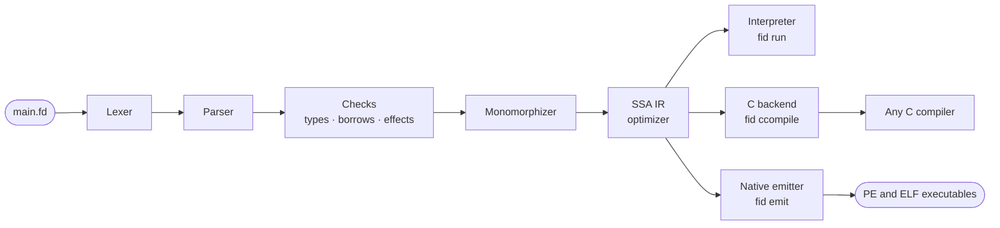

<p align="center">
  <a href="https://fid-lang.org">
    
  </a>
</p>

<h1 align="center">Fid</h1>

<p align="center">
  <b>A systems language that checks what it promises.</b><br>
  Borrow checking without lifetime annotations, capability grants on imports, effect tracking.<br>
  Its compiler, <b>Fides</b>, is written in Fid and builds itself to a byte-identical fixpoint. No LLVM. No GC.
</p>

<p align="center">
  <a href="https://fid-lang.org/playground"></a>
  <a href="https://fid-lang.org/docs/install"></a>
  <a href="https://fid-lang.org/docs"></a>
</p>

<p align="center">
  <a href="https://github.com/pledgeandgrow/fid/actions/workflows/ci.yml"></a>
  <a href="https://github.com/pledgeandgrow/fid/releases"></a>
  <a href="LICENSE"></a>
  <a href="https://github.com/pledgeandgrow/fid/discussions"></a>
</p>

<p align="center">
  <a href="#thirty-seconds-of-fid">Taste</a> ·
  <a href="#what-the-compiler-refuses">What it catches</a> ·
  <a href="#install">Install</a> ·
  <a href="#the-toolchain">Toolchain</a> ·
  <a href="#where-it-runs">Platforms</a> ·
  <a href="#how-it-works">How it works</a> ·
  <a href="#honest-status">Status</a> ·
  <a href="#contributing">Contributing</a>
</p>

---

## Thirty seconds of Fid

```rust
// hello.fd
fn main() {
    val name = "world";
    var total = 0;

    for i in 1..=100 {
        total += i;
    }

    println(f"Hello, {name}! total = {total}");
}
```

```bash
fid run hello.fd                 # interpret it: no build step
fid emit hello.fd -o hello.exe   # native executable, written by the compiler itself
fid ccompile hello.fd -o hello   # or through C, for every other target
```

`val` is immutable, `var` is mutable, types are inferred, and `f"..."` strings are part of the language. If you know Rust, Go, Zig or C, you can read Fid today: [what carries over and what differs](https://fid-lang.org/docs/coming-from).

## What the compiler refuses

Three real programs and what `fid` says about each (messages shortened to fit).

<table>
<tr>
<td width="33%" valign="top">

**A loop cannot change what it walks**

```rust
var v: Vec<i64> = Vec::new();
v.push(1);
for x in v {
    v.push(x);
}
```

```
error: borrow error in main:
cannot change v while a `for`
loop iterates over it
```

</td>
<td width="33%" valign="top">

**A module only gets what you grant**

```rust
use logger with { FS };

fn main() -> i64 {
    log_line("started");
    return 0;
}
```

```
Capability error: 'println()'
requires 'IO' capability (not
granted to module 'logger')
```

</td>
<td width="33%" valign="top">

**A pure function stays pure**

```rust
fn pure_sum(a: i64, b: i64)
    -> i64 !{} {
    return a + b + helper();
}
```

```
Effect error: function
'pure_sum' has inferred
effect '!IO'
```

</td>
</tr>
</table>

Every message is explained on the [Compiler Errors](https://fid-lang.org/docs/errors) page.

## Why Fid

|     |     |
| --- | --- |
| **No lifetime annotations** | References are second-class: they cannot be stored or returned from a local, so there is nothing to annotate. Assignment copies; nothing moves out from under you. |
| **Capabilities on imports** | `use lib with { IO }` and the compiler rejects that module's calls to the network or filesystem. Your `use` lines show what can touch what. |
| **Effects in signatures** | `!IO`, `!Net`, `!{}`: inferred across the call graph, and under-declaring is a compile error. Handlers are resumable. |
| **17 safety rules, each with a test that must fail** | `@no-alloc`, `@bounded-stack`, `@constant_time`, `@secret` and more. `fid qualify` writes the evidence as JSON. |
| **Checks that stay on** | Bounds, integer overflow and double frees panic in every build, not only in debug. |
| **No macros** | `comptime` runs ordinary Fid code at compile time, with reflection over types. |
| **No LLVM** | `fid emit` encodes machine code and writes Windows and Linux executables itself: no assembler, no linker, no C compiler. |
| **Self-hosted** | About 210K lines of Fid compile themselves to a byte-identical fixpoint, checked on every release build. |

## Install

**Windows.** Download `Fid-Setup-<version>.exe` (`Fides-Setup-<version>.exe` up to 0.8.0) from the [releases page](https://github.com/pledgeandgrow/fid/releases). It puts `fid.exe` on your PATH with the standard library beside it. The installer is not code-signed yet, so Windows will ask you to confirm.

**Linux and macOS, or from source anywhere.** You need git, Rust and a C compiler (`zig cc` 0.16 is the tested one):

```bash
git clone https://github.com/pledgeandgrow/fid && cd fid
cargo build --release                          # the Rust bootstrap compiler and tools
RELEASE=1 CC="zig cc" ./scripts/bootstrap.sh   # builds fid in 3 stages and checks the fixpoint
./release/fid run tests/bootstrap/hello.fd
```

**Nothing to install.** The [playground](https://fid-lang.org/playground) runs in your browser.

Editor support for VS Code, Neovim, Helix, Emacs and Sublime is in [`editors/`](editors/README.md); `fid lsp` speaks the Language Server Protocol.

## The toolchain

One binary, `fid`, is the compiler, interpreter, test runner, formatter, linter and language server.

| Command | What it does |
| --- | --- |
| `fid run file.fd` | Interpret a program. `--leaks` reports memory never freed |
| `fid emit file.fd -o out` | Native executable with no other tools. `--target x86_64-linux`, `aarch64-linux` or `riscv64-linux` for Linux |
| `fid ccompile file.fd -o out` | Through C; `--target` cross-compiles with `zig cc` |
| `fid check file.fd` | Type, borrow and effect checks only |
| `fid test file.fd` | Run every `test_*` function, each in its own process |
| `fid fmt` / `fid lint` | Format; unused code and `unwrap()` outside tests |
| `fid audit file.fd` | List every `unsafe` block the program reaches |
| `fid qualify file.fd` | Safety evidence as JSON: rules, their tests, annotated functions |
| `fid explain file.fd` | Which run-time checks were removed or kept, and why |
| `fid lsp` | Language server over stdio |

Beside it: `ark` (packages, from path or git), `scribe` (documentation from `///` comments) and `veil` (coverage). The full list is in the [CLI reference](https://fid-lang.org/docs/cli).

## Where it runs

| Platform          | Interpreter | Through C | Native (`fid emit`) |
| ----------------- | :---------: | :-------: | :-----------------: |
| Windows x64       |     🟢      |    🟢     |         🟢          |
| Linux x64         |     🟢      |    🟢     |         🟡          |
| Linux ARM64       |             |    🟡     |         🟡          |
| Linux RISC-V      |             |    🟡     |         🟡          |
| macOS             |             |    ⚪     |         ⚪          |
| WebAssembly       |             |    🟡     |         ⚪          |
| Bare metal x86-64 |             |           |         ⚪          |

🟢 supported · 🟡 partly tested · ⚪ experimental. Details and test counts: [platforms](docs/reference/platforms.md).

## How it works



One front end and one IR, three ways out. The native emitter has its own instruction encoders and register allocator, so no assembler or linker is involved.

The compiler checks itself as hard as it checks your code:

- **Fixpoint.** Stage 2 and stage 3 of the bootstrap must produce byte-identical output on every release build.
- **Proved rewrites.** The optimizer's 108 integer rewrite rules are proved with z3.
- **Checked encoders.** The instruction encoders are compared with clang's assembler across 1,181 forms.
- **Conformance.** 104 programs each check one rule of the [language reference](docs/reference/reference.md).

More in [verification](docs/verification/README.md) and the [contributor walkthrough](docs/reference/compiler-walkthrough.md).

## Standard library

169 modules, written in Fid. A sample:

| Area | Modules |
| --- | --- |
| Core and collections | `core`, `vec`, `collections`, `string`, `rc`, `arena`, `iter`, `sort` |
| Text and data | `json`, `toml`, `yaml`, `csv`, `regex`, `unicode`, `protobuf` |
| Network | `http`, `http2`, `net`, `dns`, `ws`, `tls_crypto`, `url` |
| Concurrency | `task`, `channel`, `sync`, `parallel`, `async` |
| Numbers and models | `math`, `bigint`, `decimal`, `tensor`, `simd`, `infer` |
| Security | `crypto`, `sha512`, `ed25519`, `x25519`, `typed_strings`, `privacy` |
| Systems | `fs`, `process`, `mmap`, `elf`, `pci`, `uart`, `virtio` |
| Games and graphics | `ecs`, `physics`, `mesh`, `gltf`, `tilemap`, `shader` |

Signatures for every module: [API reference](https://fid-lang.org/reference).

## Honest status

Fid is young and moving fast.

- **v0.8.0-unstable is a prerelease.** The stable v1.0.0 release is planned for December 2026.
- **Generated code is slower than Rust's.** Through C, Fid is fastest on one of four benchmarks and up to 1.6 times slower on the others; native output is slower still. [Benchmarks, losses included](docs/benchmarks.md).
- **No package registry yet.** `ark` installs from a path or a git repository.
- **The full test suite has not been rerun with the current compiler.** Features are checked with their own tests on each backend.
- **Not for safety-critical use.** `fid qualify` produces evidence for review, not a certification.

The details: [status](docs/reference/status.md) · [known bugs](docs/reference/known-bugs.md) · [roadmap](docs/roadmap/roadmap.md).

## Learn

| | |
| --- | --- |
| [The Fid Book](docs/book/01-intro.md) | First program to a network service |
| [University course](docs/course/README.md) | 13 weeks of lecture notes: memory safety, effect systems, capability security, systems programming; a [lab per week](docs/course/labs/README.md) that opens in the playground |
| [Coming from Rust](docs/guides/from-rust.md) · [Go](docs/guides/from-go.md) · [Zig](docs/guides/from-zig.md) · [C](docs/guides/from-c.md) · [Python](docs/guides/from-python.md) | What you already know, mapped onto Fid |
| [Language reference](docs/reference/reference.md) | Every rule, with the compiler function that enforces it |
| [Cookbook](docs/cookbook.md) | Files, JSON, HTTP, tasks |
| [Examples](examples/) | A JSON parser, an HTTP server, a mini compiler, a neural network, a game loop |
| [INDEX.md](INDEX.md) | A map of every document and compiler module |

## Repository layout

```
compiler/    the compiler, in Fid: 72 modules, about 210K lines
stdlib/      the standard library: 169 modules
src/         the earlier compiler in Rust, frozen; it builds stage 1 and runs the test harness
tests/       bootstrap (572 programs), conformance (104), selfhost (51), leak checks
examples/    twelve complete programs
docs/        book, guides, reference, proposals, roadmap, verification
editors/     VS Code, Neovim, Helix, Emacs, Sublime
installer/   the Windows installer
bench/       benchmark programs in Fid, Rust, Zig, C++ and Go
scripts/     bootstrap, cross-target tests, fuzzing, verification
```

## Contributing

Contributions are welcome, from a test program to a compiler change.

1. Read [CONTRIBUTING.md](CONTRIBUTING.md) and, before touching `compiler/*.fd`, [AGENTS.md](AGENTS.md) and the [compiler internals](docs/compiler-internals.md).
2. Build with the two commands under [Install](#install).
3. Keep a change small: one fix, one test. `RELEASE=1 ./scripts/bootstrap.sh` must still reach its fixpoint.
4. Language changes start as a [proposal](docs/proposals/0000-template.md).

Questions go to [Discussions](https://github.com/pledgeandgrow/fid/discussions), bugs to [issues](https://github.com/pledgeandgrow/fid/issues), and security problems privately through [SECURITY.md](SECURITY.md). Miscompile reports get priority.

## Questions people ask

<details>
<summary><b>How is Fid different from Rust?</b></summary>

No lifetime annotations: references cannot be stored or returned from a local. Assignment copies instead of moving. No macros; `comptime` instead. Capability grants and effect annotations are built in. Fid is younger, has no package registry, and its generated code is slower. [Full comparison](docs/guides/from-rust.md).

</details>

<details>
<summary><b>How is Fid different from Zig?</b></summary>

Both have `comptime` and their own backends. Zig leaves memory safety to the engineer; Fid checks borrows and reference escapes at compile time and keeps bounds and overflow checks in every build. [Full comparison](docs/guides/from-zig.md).

</details>

<details>
<summary><b>Why build a toolchain without LLVM?</b></summary>

Control. The IR carries Fid's own semantics (regions, effects, capabilities), and there is no external toolchain to pin. The cost is optimizer maturity: generated code is slower than LLVM's today.

</details>

<details>
<summary><b>Is it production-ready?</b></summary>

Not yet for most teams. Pilot it on a bounded tool and read [the status page](docs/reference/status.md) first.

</details>

<details>
<summary><b>What do the names mean?</b></summary>

<b>Fid</b> is the language. <b>Fides</b>, the Latin word for trust, is its compiler. <code>fid</code> is the command you type.

</details>

## Community and licence

[Website](https://fid-lang.org) · [Discussions](https://github.com/pledgeandgrow/fid/discussions) · [Changelog](docs/reference/changelog.md) · [Code of conduct](CODE_OF_CONDUCT.md) · [Support](SUPPORT.md)

Fid is maintained by Mehdi Berel at [Pledge & Grow](https://github.com/pledgeandgrow) and released under the [MIT licence](LICENSE).

<p align="center">
  <sub>If Fid is useful to you, a star helps other people find it.</sub>
</p>
